# University Library Management System - System Diagrams

This directory contains the architecture and design diagrams created according to **Section 6** of [planning.md](../../planning.md).

---

## 1. Use Case Diagram
File: `use-case-diagram.mmd`

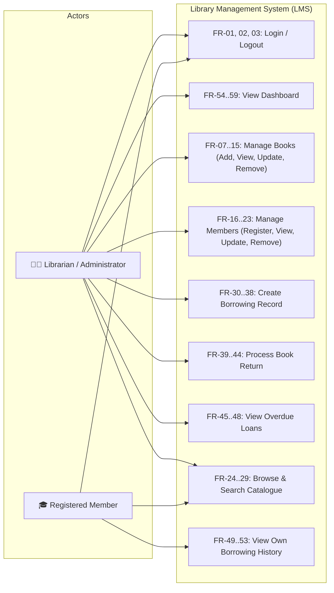

---

## 2. Activity Diagrams

### 2.1 Admin & Member Login (`activity-admin-login.mmd`)
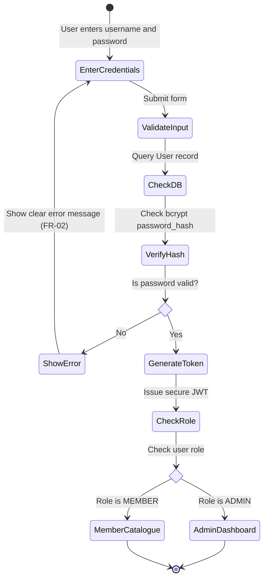

### 2.2 Add Book (`activity-add-book.mmd`)
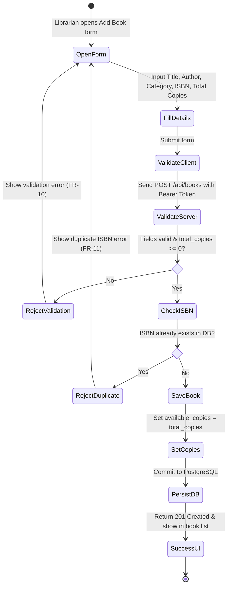

### 2.3 Register Member (`activity-register-member.mmd`)
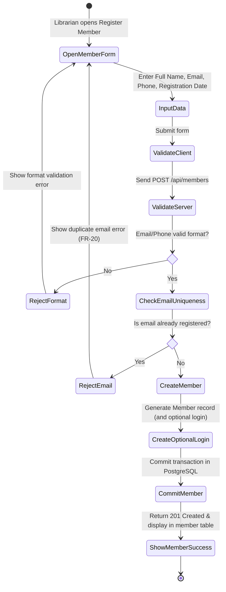

### 2.4 Borrow Book (`activity-borrow-book.mmd`)
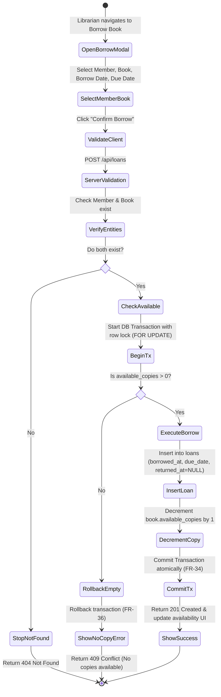

### 2.5 Return Book (`activity-return-book.mmd`)
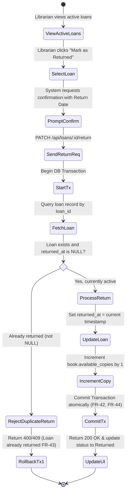

### 2.6 Search Catalogue (`activity-search-catalogue.mmd`)
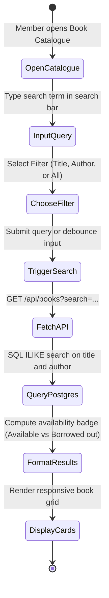

### 2.7 View Member History (`activity-view-member-history.mmd`)
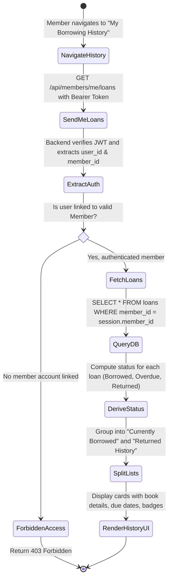

---

## 3. Data Flow Diagrams (DFD)

### 3.1 Context Diagram (Level 0 DFD - `dfd-level-0.mmd`)
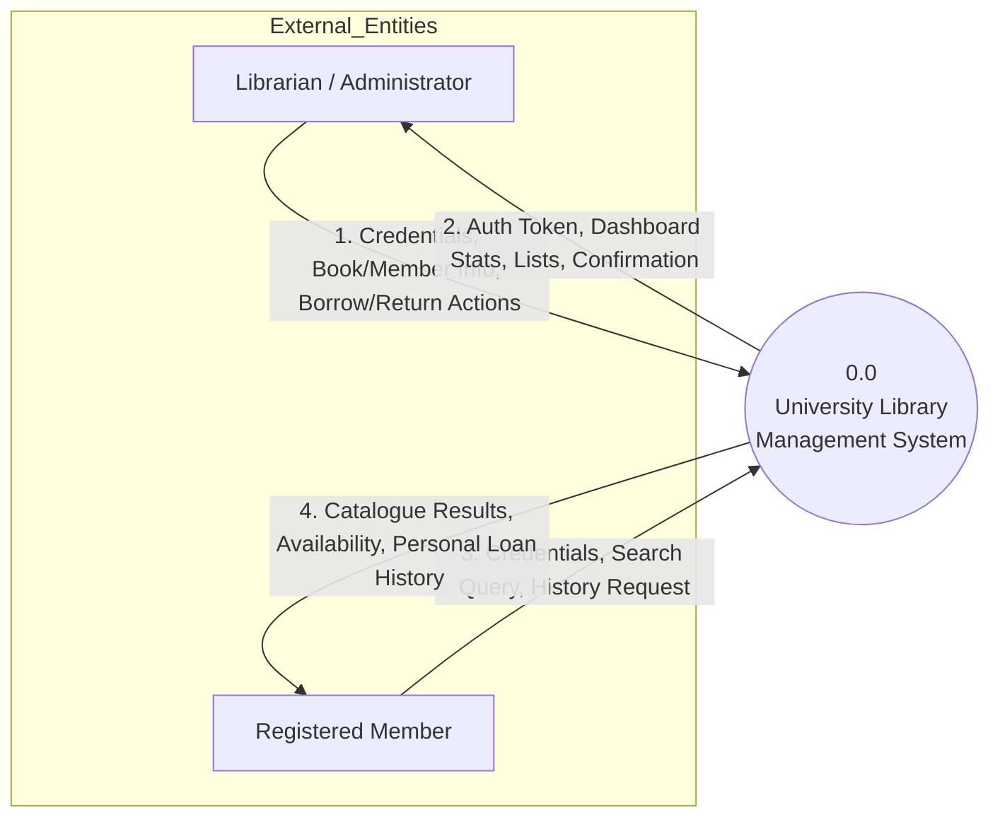

### 3.2 Level 1 DFD (`dfd-level-1.mmd`)
```mermaid
graph TD
    Librarian["Librarian / Administrator"]
    Member["Registered Member"]

    D1[("D1: Users")]
    D2[("D2: Books")]
    D3[("D3: Members")]
    D4[("D4: Loans")]

    P1(("1.0<br/>Authenticate<br/>User"))
    P2(("2.0<br/>Manage<br/>Books"))
    P3(("3.0<br/>Manage<br/>Members"))
    P4(("4.0<br/>Browse & Search<br/>Catalogue"))
    P5(("5.0<br/>Manage<br/>Borrowing"))
    P6(("6.0<br/>Process<br/>Returns"))
    P7(("7.0<br/>Generate Dashboard<br/>& Reports"))
    P8(("8.0<br/>Retrieve Member<br/>History"))

    Librarian -->|"Login Credentials"| P1
    Member -->|"Login Credentials"| P1
    P1 <-->|"Verify Hash / Token"| D1
    P1 -->|"Auth Token & Role"| Librarian
    P1 -->|"Auth Token & Role"| Member

    Librarian -->|"Book Details (CRUD)"| P2
    P2 <-->|"Read / Write Books"| D2
    P2 -->|"Book Records / Status"| Librarian

    Librarian -->|"Member Details (CRUD)"| P3
    P3 <-->|"Read / Write Members"| D3
    P3 -->|"Member Records / Status"| Librarian

    Member -->|"Search Query (Title/Author)"| P4
    P4 <--|"Read Book Data & Copies"| D2
    P4 -->|"Book List & Availability"| Member

    Librarian -->|"Borrow Request (Member + Book)"| P5
    P5 <-->|"Check Availability & Decrement Copy"| D2
    P5 <--|"Verify Member ID"| D3
    P5 -->|"Write New Loan"| D4
    P5 -->|"Borrowing Confirmation"| Librarian

    Librarian -->|"Return Request (Loan ID)"| P6
    P6 <-->|"Update returned_at"| D4
    P6 <-->|"Increment Available Copies"| D2
    P6 -->|"Return Confirmation"| Librarian

    Librarian -->|"Request Dashboard / Overdue"| P7
    P7 <--|"Count Total Books"| D2
    P7 <--|"Count Members"| D3
    P7 <--|"Count Active / Overdue Loans"| D4
    P7 -->|"Dashboard Metrics & Overdue Table"| Librarian

    Member -->|"Request My History"| P8
    P8 <--|"Query Loans for Member"| D4
    P8 <--|"Read Book Details"| D2
    P8 -->|"Current & Past Loans"| Member
```

---

## 4. Class Diagram (`class-diagram.mmd`)
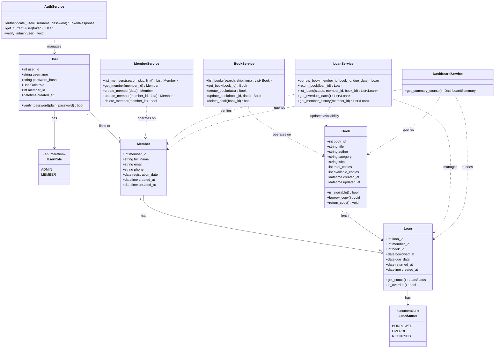

---

## 5. Entity Relationship (ER) Diagram (`er-diagram.mmd`)
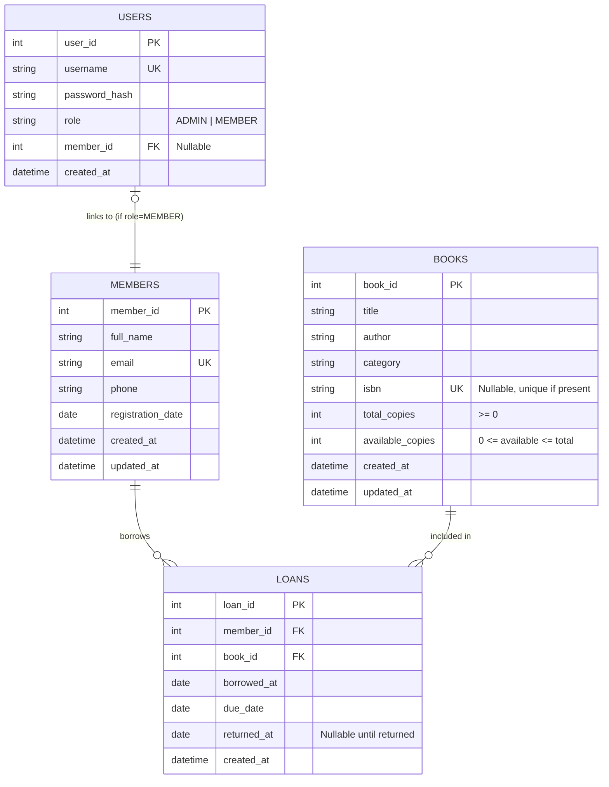
